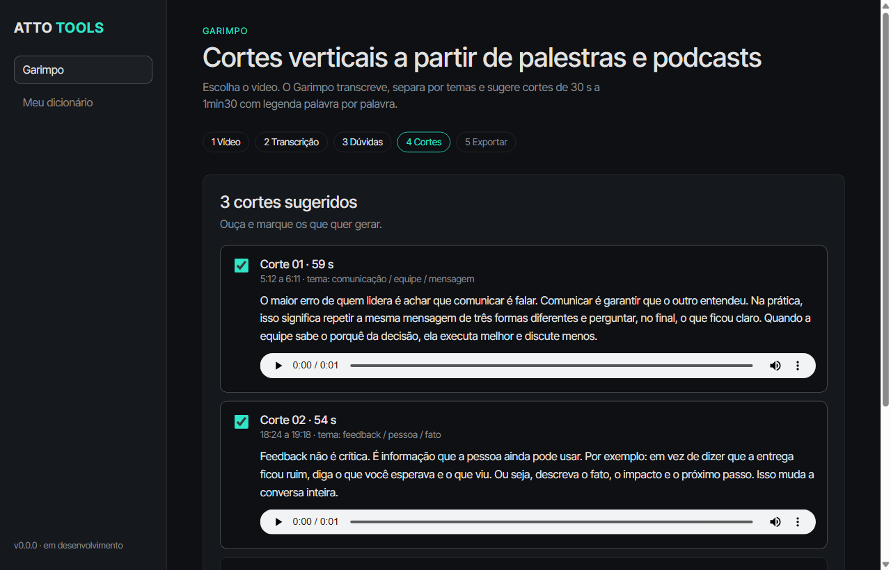
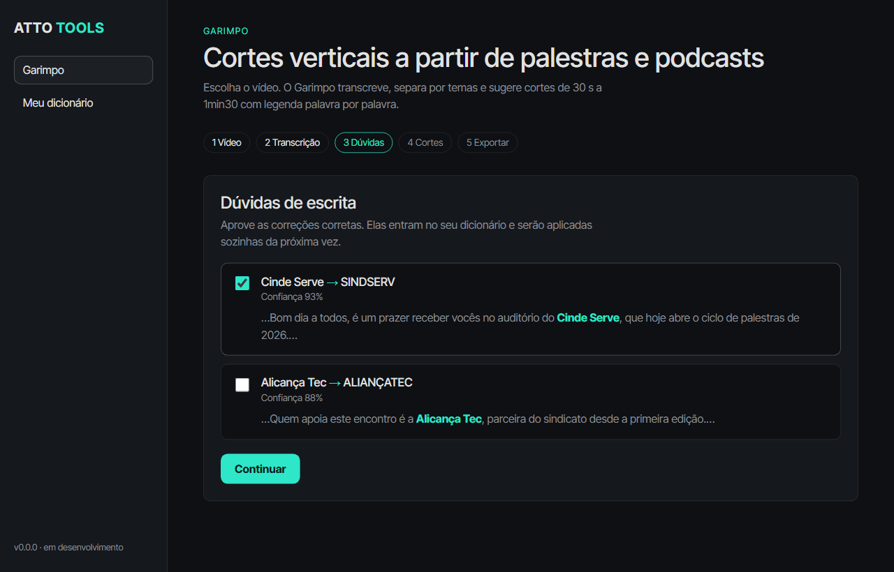
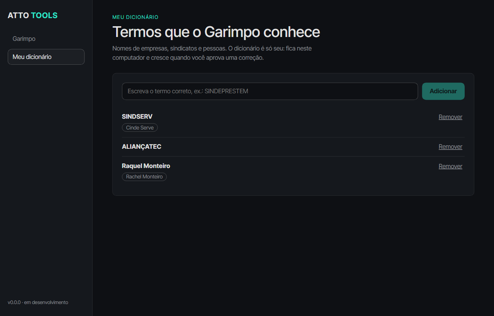
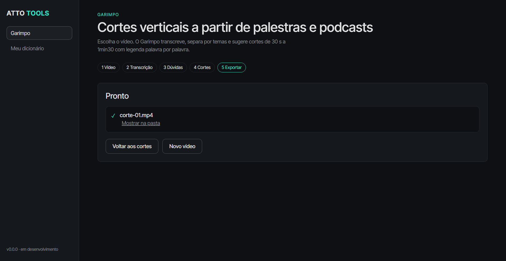
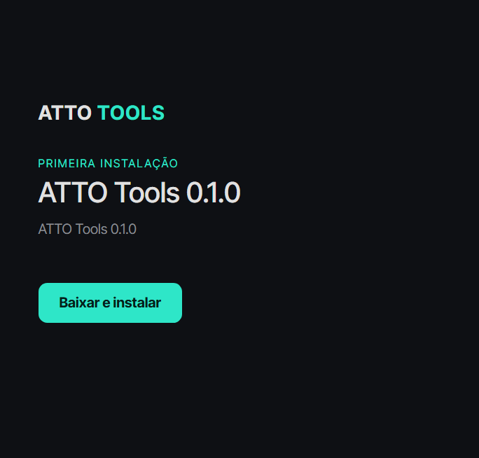

<p align="center">
  
</p>

<p align="center">
  <strong>De uma palestra de 3 horas a cortes verticais prontos para as redes.</strong><br />
  Suíte desktop da Atto Comunicação para editores de vídeo, fotógrafos, designers e jornalistas.
</p>

<p align="center">
  <a href="https://github.com/attocomunicacao/atto-comunicacao-tools/releases/latest"><strong>Baixar a última versão</strong></a> ·
  <a href="https://attocomunicacao.github.io/atto-comunicacao-tools/">Apresentação</a> ·
  <a href="docs/README.md">Documentação</a> ·
  <a href="CHANGELOG.md">Changelog</a>
</p>

<p align="center">
  <code>Windows 10/11 x64</code> · <code>local-first</code> · <code>sem mensalidade de API</code> · <code>atualização pelo Launcher</code>
</p>

---

## 01 · O que é

O **ATTO Tools** reúne ferramentas que tiram o trabalho repetitivo do dia a dia de quem cria conteúdo. A primeira é o **Garimpo**.

### Garimpo: cortes verticais com legenda dinâmica

Você escolhe o vídeo de uma palestra ou podcast (de 30 minutos a 3 horas). O Garimpo:

1. extrai o áudio e **transcreve** localmente (Whisper), guardando o tempo de cada palavra em quadros;
2. mostra as **dúvidas de escrita** (nomes de empresas, sindicatos) e aprende com o que você aprova, num **dicionário só seu**;
3. separa o texto em **frases, parágrafos e temas** (um `.md` para cada nível);
4. sugere o **trecho mais relevante de cada tema**, de 30 s a 1min30, sem cortar frases, com **prévia em áudio**;
5. gera os cortes aprovados em **MP4 vertical 1080×1920**, alta qualidade, com **legenda palavra por palavra** (Lato, maiúscula).



## 02 · Telas

> Os dados e textos das telas são **fictícios**, gerados por `npm run capturas`.

| | |
|---|---|
| <br />**Dúvidas de escrita**: aprove as correções e o dicionário aprende. | <br />**Meu dicionário**: termos e variantes que o Garimpo conhece. |
| <br />**Pronto**: vídeos gerados. | <br />**Launcher**: instala e atualiza. |

## 03 · Instalar

> **Versão 0.1.0, em testes.** O instalador do Launcher ainda não foi lançado; o pacote do app já está publicado.

**Requisitos:** Windows 10/11 x64, 8 GB de RAM (16 GB recomendado), cerca de 3 GB livres. Placa de vídeo dedicada não é necessária: a transcrição roda no processador, então gravações longas demoram.

**Instalação manual (por enquanto):**
1. Em [Releases](https://github.com/attocomunicacao/atto-comunicacao-tools/releases/latest), baixe `ATTO-Tools-0.1.0-win-x64.zip` (cerca de 886 MB).
2. Extraia em uma pasta e abra `ATTO Tools.exe`.
3. O Windows SmartScreen pode avisar, porque o app ainda não é assinado: *Mais informações* → *Executar assim mesmo*.

**Como o Launcher atualiza:**

```
manifest.json da release → baixa o .zip → confere o SHA-256 → instala lado a lado → troca a versão atual
                                                  │ não confere: nada é instalado
                                                  └ guarda a versão anterior para voltar com um clique
```

## 04 · Princípios

- **Local-first:** vídeo, áudio e texto não saem do seu computador.
- **Custo zero por uso:** sem API paga nem mensalidade.
- **Nada é publicado sozinho:** você ouve e aprova cada corte.
- **Seu dicionário é seu:** guardado localmente, nunca compartilhado entre usuários.

## 05 · Arquitetura

```
apps/
  launcher/   Launcher (Electron + TypeScript): instala e atualiza
  desktop/    ATTO Tools (Electron + React 19 + TypeScript)
  engine/     Motor do Garimpo (Python 3.12, uv)
scripts/
  package/    Empacota o app (Electron + Python + FFmpeg + modelo + fontes)
  release/    Gera o manifest.json da release
website/      Página de apresentação (GitHub Pages)
docs/         Decisões, design, diário de desenvolvimento e capturas
```

| Camada | Tecnologia |
|---|---|
| Interface | Electron 45, React 19, Vite (electron-vite), identidade visual da ATTO |
| Motor | Python 3.12 (uv), faster-whisper (`small`, int8, CPU), FFmpeg |
| Correção | Dicionário pessoal + busca fonética (sem LLM, rápido em CPU) |
| Temas e cortes | Pausas, vocabulário raro (TF-IDF) e regras de relevância |
| Legenda | ASS, Lato maiúscula, destaque `#2ee6c8` |
| Entrega | Launcher + GitHub Releases (zip + SHA-256) |

## 06 · Desenvolvimento

**Requisitos:** Node.js 24+, Python 3.12, [uv](https://docs.astral.sh/uv/), FFmpeg no PATH, Git.

```bash
npm install
cd apps/engine && uv sync && cd ../..
npm run dev:desktop      # abre o ATTO Tools
```

| Comando | O que faz |
|---|---|
| `npm run dev:desktop` / `npm run dev:launcher` | abre o app / o launcher em desenvolvimento |
| `npm test` | testes do launcher |
| `cd apps/engine && uv run pytest` | testes do motor |
| `npm run capturas` | gera as capturas de tela (dados fictícios) |
| `npm run instalador` | gera o instalador do Launcher: `dist/launcher/ATTO-Tools-Setup-<versão>.exe` |
| `npm run package -- --versao 0.1.0` | gera `dist/ATTO-Tools-<versão>-win-x64.zip` e o `manifest.json` |

**Publicar uma versão:** gere o pacote e crie uma Release `vX.Y.Z` com o `.zip` e o `manifest.json` (`gh release create`). O Launcher lê o `manifest.json` da última release.

A história de cada etapa do desenvolvimento está em [`docs/diario`](docs/diario).

## 07 · Licença

© 2026 Atto Comunicação. Todos os direitos reservados. Veja [`LICENSE`](LICENSE) e [`THIRD_PARTY_NOTICES.md`](THIRD_PARTY_NOTICES.md) (o pacote inclui FFmpeg sob GPL v3 e outros componentes de terceiros).
