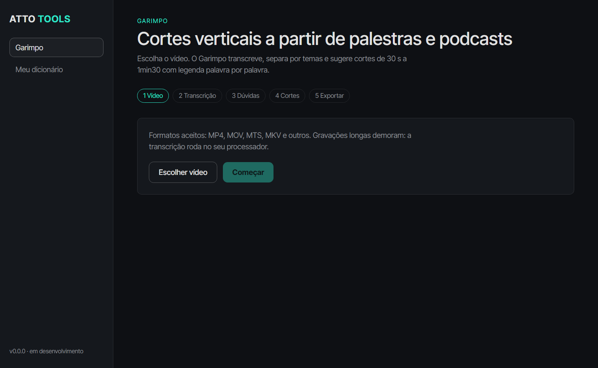

# 008 · Janela do app (2026-11-06)

`apps/desktop`: Electron 45 + React 19 + electron-vite, identidade ATTO (fundo `#0e1014`, destaque `#2ee6c8`, Inter Tight).



## Telas
1. **Vídeo**: escolher arquivo e começar.
2. **Transcrição**: progresso (o motor emite `ETAPA n/total`).
3. **Dúvidas**: lista com contexto; o que o usuário aprova entra no dicionário pessoal.
4. **Cortes**: prévia em áudio, texto e aprovação de cada corte.
5. **Exportar**: gera os MP4 verticais e mostra na pasta.
- **Meu dicionário**: adicionar e remover termos.

## Como funciona
- O app chama o motor por `uv run --project apps/engine garimpo <comando>` (comandos novos: `transcrever`, `estruturar`, `dicionario`).
- Ponte segura: `contextIsolation` + `sandbox`, comandos em lista fechada e leitura de arquivos só dentro da pasta de projetos (`%APPDATA%/@atto/desktop/projetos`).
- Autoteste visual: `ATTO_CAPTURA=arquivo.png electron . --disable-gpu` salva uma imagem da janela.

## Rodar
```bash
npm install
npm run dev:desktop
```

## Verificado
Build e typecheck ok; janela abre e renderiza; motor é chamado pelo Node (comando `dicionario`).
## Não verificado
O fluxo completo clicando nas telas (seleção de vídeo, dúvidas, cortes, exportação) ainda não foi exercitado de ponta a ponta. Em um teste a aceleração de GPU do Electron falhou neste computador (janela só abriu com `--disable-gpu`); investigar antes do instalador.
