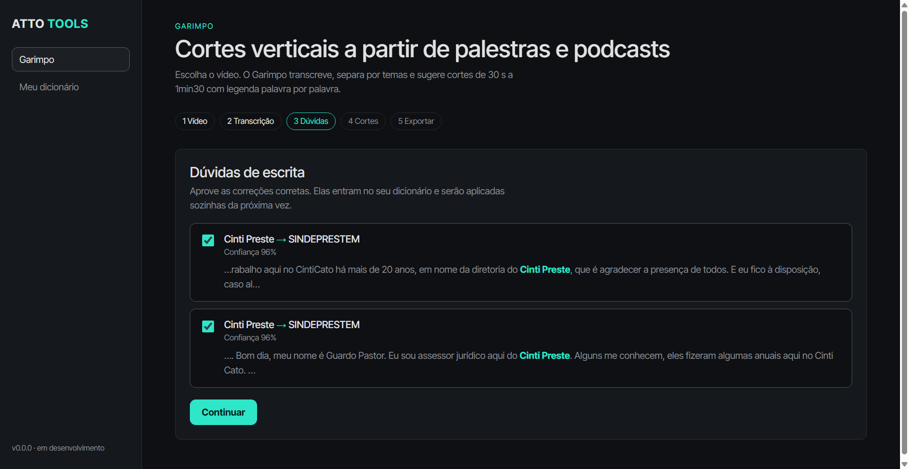
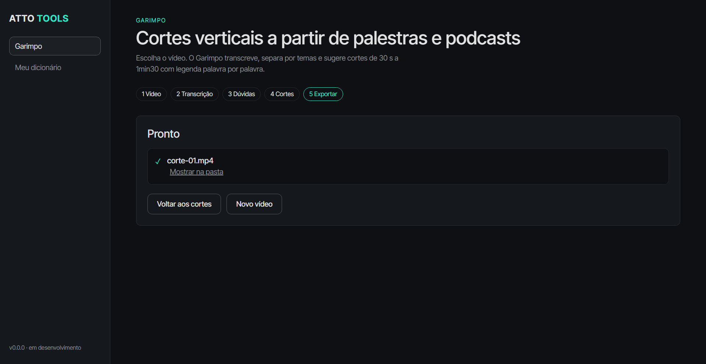

# 009 · Teste do fluxo completo pelo app (2026-11-06)

Script `apps/desktop/scripts/e2e.mjs` abre o Electron, controla a janela pelo protocolo de depuração (CDP) e clica as telas. O diálogo de arquivo é substituído por `ATTO_VIDEO_TESTE=<video>` (só para teste).

```bash
ATTO_VIDEO_TESTE=<video.mp4> node apps/desktop/scripts/e2e.mjs apps/desktop <pasta-de-capturas>
```

## Resultado: sucesso, com um clipe de 15 min
| Etapa | Resultado |
|---|---|
| Escolher vídeo e começar | ok |
| Transcrição | ~5 min, barra de progresso |
| Dúvidas | 2 sugestões de "Cinti Preste → SINDEPRESTEM", aprovadas |
| Continuar | 3 cortes sugeridos, 3 prévias de áudio carregadas |
| Gerar 1 corte | MP4 1080x1920, H.264 + AAC, 61 s, 36 MB, legenda Lato maiúscula com destaque `#2ee6c8` |
| Dicionário | aprendeu "Cinti Preste" como variante de SINDEPRESTEM |




## Problemas e observações
- **Exportação lenta:** 1 corte de 61 s levou ~6 min na CPU (decodifica HEVC 1080p, fundo desfocado, H.264 `preset medium` CRF 16). Ideias: `preset faster`, decodificação por hardware (Intel Quick Sync) e gerar vários cortes em paralelo. Qualidade máxima continua sendo requisito.
- **GPU do Electron:** só funciona com `--disable-gpu` neste computador; o teste usa essa opção.
- Projetos ficam em `%APPDATA%\@atto\desktop\projetos`; o Electron ignora a variável `APPDATA` (o motor Python respeita), então o teste não isola a pasta de projetos.
- Cortes: o corte 1 ainda é "conversa sobre o formato do debate" (ver diário 007).
