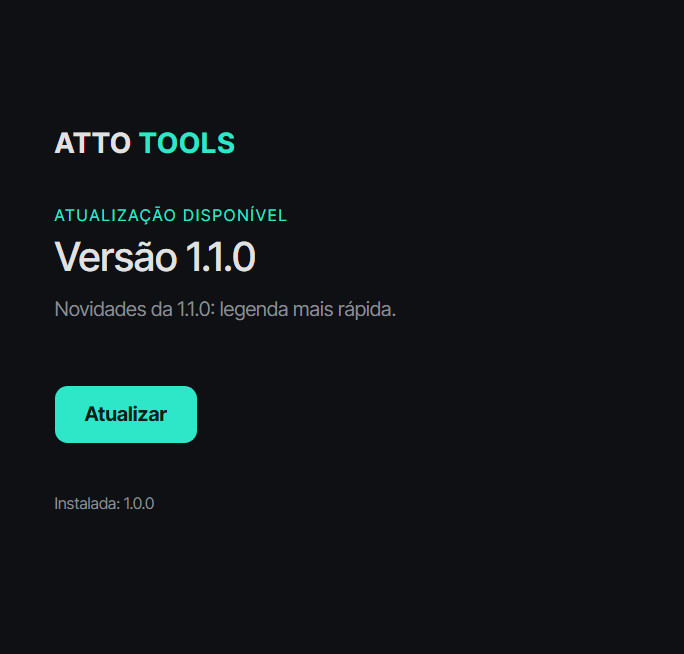

# 011 · Launcher (2026-11-06)

`apps/launcher`: pequeno app Electron (identidade ATTO) que instala o ATTO Tools e recebe as atualizações.

## Como funciona
1. Consulta `https://github.com/attocomunicacao/atto-comunicacao-tools/releases/latest/download/manifest.json`.
2. Baixa o pacote `.zip` da release (só aceita endereços da release do repositório).
3. Confere o **SHA-256**; se não bater, nada é instalado e a versão atual continua.
4. Extrai **lado a lado** em `%LOCALAPPDATA%\ATTO Tools\versions\<versão>` e só então troca a versão atual.
5. Guarda a versão anterior para **voltar** com um clique; versões mais antigas são apagadas.
6. Sem internet, com o app instalado, o botão **Abrir** continua funcionando.

`scripts/release/gerar-manifest.mjs <pacote.zip> <versão>` gera o `manifest.json` (com SHA-256) que acompanha a release.

## Testes
- `npm test -w apps/launcher`: 4 testes (versões, instalar/atualizar/voltar, SHA-256 inválido, endereço não permitido), com servidor HTTP local.
- `apps/launcher/scripts/e2e.mjs`: abre a janela, simula uma release falsa e percorre: primeira instalação → atualização 1.0.0 → 1.1.0 → voltar → sem conexão. Passou.

## Ainda falta (para o launcher funcionar de verdade)
- **Pacote do ATTO Tools** (`.zip` com `ATTO Tools.exe`): empacotar o app com electron-builder, embarcando o motor Python (uv, Whisper, FFmpeg, Lato). Hoje o app roda só em desenvolvimento.
- **Workflow `release.yml`** do GitHub Actions: ao criar uma tag `vX.Y.Z`, gerar pacote, manifest e Release.
- **Instalador do launcher** (`.exe` para o usuário baixar) e **atualização do próprio launcher**.
- Assinatura de código (o Windows SmartScreen vai avisar sem ela).
- O botão "Abrir" ainda não foi testado com um app real (só com executável de mentira, que não é executado nos testes).
